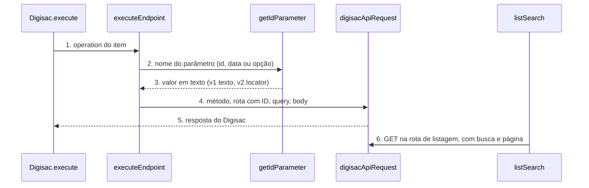

# Digisac: node-cli 0.55 e campos guiados (versão 2 do node)

**Approved**: 2026-11-06 - user: "Aprovo com antecedência (Recomendado · Jev 0,96)"

> Build this with **tlc-implement**. Every criterion becomes a check with a proof; nothing under
> the open questions is settled while building.

## Problem

O pacote `n8n-nodes-digisac` 1.0.3 compila com `tsc` + `gulp` e roda `npm run generate:endpoints` dentro do `build`, que baixa a coleção Postman da rede a cada build. O `n8n-node lint` do `@n8n/node-cli` 0.55.5, que a guideline de verificação do n8n exige, acusa 9 erros no código do node (4 `node-param-default-missing`, 1 `node-param-display-name-miscased`, 1 `node-param-description-boolean-without-whether`, 3 `no-explicit-any`, 1 `no-unused-vars`; 4 corrigíveis por `--fix`). O pacote não tem nenhum teste automatizado, e o README é um texto curto que não segue o padrão completo dos outros nodes.

O node cobre 298 chamadas da API do Digisac em 51 recursos. Quem preenche digita à mão o ID de 32 tipos de ID de path (`contactId` aparece em 37 operações, `serviceId` em 8) e o ID de serviço, departamento e usuário nos filtros de query e no body. Também digita datas em texto livre (`startPeriod`, `endPeriod`, `from`, `to` em cerca de 25 operações) e valores fixos em texto livre (`status`, `periodType`, `type`, `departmentParticipation`, `userParticipation`, `origin`). Para achar um ID, a pessoa sai do n8n e procura no Digisac. A UX guideline do n8n manda usar Resource Locator com `From list` como padrão.

Quando isso sair: o lint oficial passa sem erro, o build não depende de rede, e em node novo os 8 IDs principais mostram uma lista pesquisável vinda da conta, as datas têm seletor de data e os valores fixos viram lista de opções. Workflows salvos continuam funcionando sem nenhuma edição.

## Shape

Reutiliza o catálogo gerado (`DIGISAC_ENDPOINTS`), a montagem de path, query e body de `executeEndpoint` e o transporte `digisacApiRequest`; os modos de lista do Resource Locator chamam as mesmas rotas de listagem do catálogo. A regra que muda o resultado, ler o ID, a data e a opção da versão 1 (texto) ou da versão 2 (Resource Locator, data, opção), fica numa função única de leitura de ID chamada por `executeEndpoint` para path, query e body, e os testes a alcançam pelo `execute` do node.

1. entra o item do workflow -> `Digisac.execute` (exists) - lê `operation` e chama `executeEndpoint`
2. `executeEndpoint` (exists) - acha a chamada no catálogo e monta path, query e body
3. `getIdParameter` (new) - na versão 1 devolve o texto do parâmetro; na versão 2 devolve o `value` do Resource Locator sem espaços nas pontas; as datas da versão 2 saem em ISO UTC
4. `digisacApiRequest` (exists) - monta a requisição com a Base URL da credencial, `timeout` explícito, e chama `httpRequestWithAuthentication`
5. out: a resposta do Digisac como itens do n8n, igual à 1.0.3
6. `listSearch` (new) - o editor do n8n pede a lista de um ID; chama `digisacApiRequest` na rota de listagem do tipo, com texto de busca e página

**Changes underneath**

| Front | What changes |
| --- | --- |
| domain | nada: recursos e operações não mudam |
| stored data | nothing to migrate: workflows salvos guardam `typeVersion` 1 e continuam lendo os parâmetros em texto |
| readers | o editor do n8n mostra a versão 2 só em node novo |
| toolchain | `package.json`, `eslint.config.mjs`, `tsconfig.json`, `gulpfile.js` e os workflows de CI e publicação passam para o padrão do template do node-cli 0.55.5 |
| generators | `generate:endpoints` e `generate:docs` saem do `build`; `generate:docs` deixa de sobrescrever o README (AD-008, AD-009) |

Data: none - o node não guarda dado; ele só repassa a requisição para o Digisac e devolve a resposta.

New: nothing - read only.

## Surface

| Route | In | Out | Status | Who |
| --- | --- | --- | --- | --- |
| node `digisac` versão 2 | IDs como Resource Locator `{ mode, value }` (mode `list` ou `id`), datas em `dateTime`, valores fixos em `options` | a mesma resposta da versão 1 | `200`; `401` do Digisac com token inválido vira `NodeApiError`; demais `4xx` e `5xx` também | quem tem credencial Digisac válida; sem ela o Digisac devolve `401` |
| node `digisac` versão 1 | IDs, datas e valores em texto, iguais à 1.0.3 | igual à 1.0.3 | `200`; `401` do Digisac com token inválido vira `NodeApiError` | workflows salvos com credencial Digisac válida; sem ela o Digisac devolve `401` |
| `listSearch` de cada ID | texto de busca e `paginationToken` | `{ results: [{ name, value }], paginationToken? }` | `200`; `401` do Digisac com token inválido vira `NodeApiError` | o editor do n8n com credencial Digisac válida; sem ela o Digisac devolve `401` |

## Landing

| One-way door | Literal shape | Alternative rejected |
| --- | --- | --- |
| versão do node | `version: [1, 2]`, `defaultVersion: 2`; campos novos com `displayOptions.show['@version']: [{ _cnd: { gte: 2 } }]` e antigos com `[1]` | `VersionedNodeType` (versão completa): reescreve o node sem necessidade |
| nome dos parâmetros na versão 2 | o mesmo `name` da versão 1 (ex.: `path_e001_contactId`), só o `type` muda | nome novo: obrigaria mapear dois nomes em cada uma das 298 operações |
| formato do valor do ID na versão 2 | Resource Locator `{ __rl: true, mode: 'list' \| 'id', value: '<id>' }` em todo ID de path; os 8 tipos com lista levam os dois modos, os outros 24 só o modo `id` (AD-006, AD-007) | string com dica de texto: não segue a UX guideline |
| versão do pacote | `1.1.0` (minor: nenhum workflow salvo quebra) | `2.0.0`: sem quebra de contrato não se justifica |
| nome do pacote no npm | `n8n-nodes-digisac` (o dono já o publica, versão 1.0.3, com provenance); `npm view` confirmou que `n8nnodesdigisac` e `n8n-nodes-digi-sac` não existem, então nenhum nome igual sem pontuação bloqueia o stage | renomear para `@pexuleco/...`: quebraria a instalação de quem já usa |

- Nothing else in this change is hard to reverse

## Criteria

### S1: toolchain do node-cli 0.55.5 e build sem rede (P1)

O pacote compila, passa no lint oficial e roda os testes com os comandos do template, sem baixar nada da rede.

**Acceptance Criteria**

1. WHEN `npm run build` roda sem rede THEN o sistema SHALL sair com código 0 e gerar `dist/nodes/Digisac/Digisac.node.js`, `dist/credentials/DigisacApi.credentials.js` e os ícones ao lado de cada um
2. WHEN `npm run lint` roda THEN `n8n-node lint` SHALL sair com código 0 e imprimir 0 erros (medido em 1.0.3: 9 erros)
3. The `package.json` SHALL ter `"build": "n8n-node build"`, `"lint": "n8n-node lint"`, `"n8n.strict": true`, `@n8n/node-cli` `0.55.5` e `n8n-workflow` `^2.46.5` em `devDependencies`, `peerDependencies` `{ "n8n-workflow": "*" }`, nenhum campo `dependencies` e nenhuma referência a `gulp`
4. The `package-lock.json` SHALL resolver `n8n-workflow` na versão 2.46.0 ou mais nova
5. The `package.json` SHALL manter os scripts `generate:endpoints` e `generate:docs`, e o script `build` SHALL NOT chamar nenhum dos dois
6. WHEN um Pull Request abre THEN o workflow de CI (arquivo ci.yml em .github/workflows) SHALL rodar `npm ci`, `npm run lint`, `npm test` e `npm run build`, com `node-version` igual à do workflow de publicação
7. WHEN `npm test` roda THEN o sistema SHALL compilar e rodar `node --test test/*.test.cjs` com saída `# fail 0`

### S2: versão 1 continua igual (P1)

Workflow salvo na versão 1 envia exatamente a mesma requisição da 1.0.3.

**Acceptance Criteria**

1. WHEN o `execute` roda com `typeVersion` 1, `operation` `e001`, `path_e001_botId` `'b1'`, `path_e001_contactId` `'c1'` e `queryKey_e001_flag` `'flagAqui'` THEN o sistema SHALL chamar `POST` em `/api/v1/bots/b1/trigger-signal/c1` com `qs` `{ flag: 'flagAqui' }`, base da credencial `digisacApi` e `timeout` definido
   - `path_e001_contactId` com espaço nas pontas `' c1 '` → rota usa `c1` codificado, igual à 1.0.3
2. IF `path_e001_contactId` chega vazio na versão 1 THEN o sistema SHALL lançar `NodeOperationError` com a mensagem `Missing required path parameter for POST /api/v1/bots/{{botId}}/trigger-signal/{{contactId}}`
3. The node SHALL listar, para `@version` 1, todo parâmetro com o mesmo `name` e o mesmo `type` da 1.0.3, para as 298 operações
4. WHEN `executeEndpoint` roda com `Response Format` `Text` THEN o sistema SHALL devolver `{ data: <texto> }`, igual à 1.0.3

### S3: IDs guiados na versão 2 (P1)

Em node novo, os 8 IDs principais são Resource Locator com lista pesquisável e modo ID, e os outros IDs de path são Resource Locator só com modo ID.

**Acceptance Criteria**

1. WHEN alguém adiciona o node a um workflow novo THEN o sistema SHALL criá-lo com `typeVersion` 2
2. The node SHALL expor, para `@version` 2, como `resourceLocator` com modos `list` (padrão, `searchable: true`) e `id`, todo parâmetro de path de `contactId`, `serviceId`, `departmentId`, `userId`, `tagId`, `roleId`, `botId` e `ticketTopicId`, e os campos `serviceId`, `departmentId` e `userId` de query, e as chaves `contactId`, `userId`, `serviceId` e `departmentId` dos Campos do Body, nas operações onde cada um existe
3. The node SHALL expor, para `@version` 2, como `resourceLocator` só com o modo `id`, os 24 tipos de ID de path restantes (por exemplo `ticketId`, `messageId`, `cardsId`, `campaignsId`)
4. WHEN o `execute` roda com `typeVersion` 2, `operation` `e001`, `path_e001_contactId` `{ mode: 'list', value: 'c1' }` e `path_e001_botId` `{ mode: 'id', value: ' b1 ' }` THEN o sistema SHALL chamar `POST` em `/api/v1/bots/b1/trigger-signal/c1` (espaço nas pontas removido)
5. IF o Resource Locator de path chega com `value` vazio THEN o sistema SHALL lançar `NodeOperationError` com a mensagem `The 'Contact Id' parameter is empty [item 0]` e a descrição `Choose a contact from the list or paste its ID`
6. WHEN um campo de query de ID da versão 2 recebe `{ mode: 'id', value: 'all' }` THEN o sistema SHALL enviar `all` na query, porque a documentação usa `all` como valor de departamento e usuário
7. WHEN o editor pede a lista de contatos com o texto `5511` THEN o `listSearch` SHALL chamar `GET /api/v1/contacts` com `perPage` `50`, `page` `1` e `where[data.number][$iLike]` `%5511%`, e devolver `{ results: [{ name, value }] }`
   - texto `ana` → a busca usa `where[name][$iLike]` `%ana%` (Assumptions: confirmar com conta real); texto vazio → sem filtro
8. WHEN o editor pede a lista de cada um dos outros 7 tipos (`serviceId`, `departmentId`, `userId`, `tagId`, `roleId`, `botId`, `ticketTopicId`) THEN o `listSearch` SHALL chamar `GET` em `/api/v1/services`, `/api/v1/departments`, `/api/v1/users`, `/api/v1/tags`, `/api/v1/roles`, `/api/v1/bots` e `/api/v1/ticket-topics`, uma página de `perPage` `50` por chamada, e filtrar o texto de busca no próprio node sem diferenciar maiúscula nem acento
9. WHEN a página devolvida tem 50 itens THEN o `listSearch` SHALL devolver `paginationToken` com o número da próxima página; IF a página tem menos de 50 itens THEN o `listSearch` SHALL omitir `paginationToken`, e SHALL NOT baixar todas as páginas numa chamada
   - 50 itens na página 1 → token `2`; 12 itens → sem token
10. IF o Digisac responde `401` à chamada do `listSearch` THEN o sistema SHALL lançar `NodeApiError` com o código HTTP `401`
11. WHEN o `execute` roda com `typeVersion` 2 e um parâmetro de ID ainda no formato de texto (workflow migrado à mão) THEN o `getIdParameter` SHALL aceitar o texto e usá-lo como `value`

### S4: datas e valores fixos guiados na versão 2 (P2)

Em node novo, as datas têm seletor e os valores fixos documentados viram lista de opções.

**Acceptance Criteria**

1. The node SHALL expor, para `@version` 2, como `dateTime`, os campos de query `startPeriod`, `endPeriod`, `from` e `to` de todas as operações onde existem
2. WHEN o `execute` roda com `typeVersion` 2, `operation` `e101` e `queryKey_e101_startPeriod` `2026-01-01T00:00:00.000-03:00` THEN o sistema SHALL enviar `startPeriod` `2026-01-01T03:00:00.000Z` na query
3. IF o valor de data da versão 2 não é uma data válida THEN o sistema SHALL lançar `NodeOperationError` com a mensagem `The 'Start Period' parameter is not a valid date [item 0]`
4. The node SHALL expor, para `@version` 2, como `options`, os campos cujo placeholder da documentação lista alternativas: `status` (`all`, `open`, `close`), `periodType` (`all`, `close`, `open`; ou `openDate`, `closeDate` onde o placeholder é `{{open/close}}Date`), `type` (`csat`, `nps`), `departmentParticipation` e `userParticipation` (`last`, `middle`)
5. WHEN o `execute` roda com `typeVersion` 2, `operation` `e112`, `queryKey_e112_type` `'nps'` e `queryKey_e112_periodType` `'open'` THEN o sistema SHALL enviar `type=nps` e `periodType=open` na query
6. The node SHALL expor o campo `origin` do body das operações de envio de mensagem como `options` com `bot` e `user`, e na versão 1 ele continua texto
7. WHEN o `execute` roda com `typeVersion` 1 e `queryKey_e101_startPeriod` `'2026-01-01T00:00:00.000Z'` THEN o sistema SHALL enviar o texto sem conversão

### S5: documentação e lançamento 1.1.0 (P2)

A versão nova chega ao npm com provenance, pelo stage com aprovação do dono, e a documentação segue o padrão completo.

**Acceptance Criteria**

1. The `package.json` SHALL ter `"version": "1.1.0"`, o campo `funding` do tipo `individual` apontando para a página do dono no Buy Me a Coffee (qTny0AzFXS), e o `CHANGELOG.md` SHALL ter a seção `## 1.1.0` listando a migração do toolchain, a versão 2 do node e a correção do lint
2. The README SHALL ter o selo e a seção Apoie o projeto, índice, Funcionalidades, Instalação, Credenciais, Nós e Operações, Usar como Tool de Agente de IA, exemplos, Desenvolvimento, Compatibilidade, Recursos, Publicação, Versões, Suporte e Licença, no padrão do README do RD Station CRM; o README SHALL NOT ter seção Trigger, porque o pacote não tem trigger
3. WHEN `npm run generate:docs` roda THEN o sistema SHALL regravar `docs/api-calls.md` e só a tabela de recursos entre marcadores do README, e SHALL NOT sobrescrever o restante do README
4. The workflow de publicação (arquivo publish.yml) SHALL rodar `npx -y npm@12.2.2 stage publish --provenance --access public` com `RELEASE_MODE: 'true'` no passo, `workflow_dispatch` no `on:`, a mesma `node-version` do workflow de CI e os passos `npm ci`, validação da tag, lint, teste e build antes do stage
5. WHEN a tag `v1.1.0` chega ao GitHub THEN o workflow de publicação SHALL mandar `n8n-nodes-digisac@1.1.0` para o stage do npm com provenance, e depois da aprovação do dono `npm view n8n-nodes-digisac version` SHALL devolver `1.1.0`

## Out of scope

| Excluded | Why |
| --- | --- |
| Resource Locator com lista para os outros 24 tipos de ID | Só os 8 tipos de AD-006 têm rota de listagem confirmada e uso alto; os outros ficam só com o modo `id` (AD-007) |
| `fixedCollection` para o body de mensagem interativa, `customFields`, `parameters` de template e `where` | A documentação mostra só exemplos de JSON, não um esquema de campos; sem esquema, o campo viraria invenção |
| Enum para `grouping` e para `type` do body de mensagem | A documentação deixa `grouping` vazio nas 7 operações e só mostra `chat` para `type`; os valores não estão confirmados |
| Datas dos filtros `filters[createdAt]` e `filters[endedAt]` de ausências | O modelo da documentação traz um placeholder com sufixo `Z` colado, que não tem formato confirmado |
| Parâmetro de simplificar a saída | O pedido é sobre o preenchimento dos campos, não sobre a saída |
| Novas operações ou recursos | O pedido não pediu; o catálogo vem da coleção Postman |
| Tradução ou revisão dos rótulos em português e inglês misturados | Fora do pedido; o lint novo só exige Title Case onde acusa |
| A pasta local `pedro/` e sua subpasta `docs/` | São diretórios vazios sem arquivo versionado pelo git; nada a mudar e nada a apagar |

## Assumptions

| Assumption | Chosen default | Rationale | Confirmed? |
| --- | --- | --- | --- |
| Formato da resposta de listagem | `{ data: [...] }`; se a resposta vier como array puro, usa o array | A coleção Postman não traz exemplo de resposta; o formato `data`, `total`, `currentPage`, `lastPage` vem de uma fonte de terceiro (anythingmcp.com/marketplace/digisac) | n |
| Fim da lista | A página com menos de 50 itens é a última | Não depende de `lastPage`, que não está confirmado | n |
| Busca de contato por nome | `where[name][$iLike]=%texto%`, o mesmo operador que a documentação usa em `where[data.number][$iLike]` | A documentação confirma `$iLike` só para o número; o nome é o mesmo operador em outro campo. Se a API recusar numa conta real, a busca por nome cai para o filtro no node, página por página | n |
| Rótulo de cada item da lista | `name`, senão `label`, senão `data.number`, senão o `id` | A coleção não mostra os campos de resposta | n |
| Rotas de listagem por tipo | `contacts`, `services`, `departments`, `users`, `tags`, `roles`, `bots`, `ticket-topics`, todas em `/api/v1/` | Cada rota aparece como listagem `GET` com `perPage` na coleção Postman oficial (consulta feita em 06/11/2026; Context7 não indexa o Digisac) | y |
| Paginação | `perPage=50` e `page=N` na query | A coleção usa `perPage=40` em quase toda listagem e `"page":1,"perPage":50` no JSON de `query`; 50 é o valor de `/api/v1/services` | n |
| Idioma dos rótulos novos | Inglês, Title Case, como a UX guideline do n8n | O pacote já mistura os dois e o lint pede Title Case | n |
| Uso como Tool de Agente de IA com Resource Locator | O agente preenche o modo `id` por `$fromAI`; a descrição de `usableAsTool` continua valendo | O node 1.0.3 já se descreve como tool; o comportamento do Resource Locator em tool deve ser provado no teste de integração local | n |
| Workflow de publicação | Mantém o gatilho de tag `v*` e ganha `workflow_dispatch` | O dono precisa poder republicar e reaprovar sem mover a tag | n |

**Open questions:** none - all resolved or logged above.

## Differences from the source

None - the product matches the source

## Sources

- Pedido do dono, 06/11/2026: "atualizar e melhorar todos os nodes n8n de acordo com a nova versao, deixar mais facil e intuitivo o preenchimento dos campos, sempre consultar a doc da ferramenta do node" - binding - escopo do trabalho
- Coleção Postman oficial do Digisac, `https://documenter.getpostman.com/view/53282970/2sBXihpXmF` (JSON em `https://documenter.gw.postman.com/api/collections/53282970/2sBXihpXmF`), lida em 06/11/2026 - binding - rotas de listagem, paginação, operador `$iLike`, alternativas de enum
- Template e guias do `@n8n/node-cli` 0.55.5 e UX guideline do n8n - binding - toolchain, versão leve, Resource Locator
- Medição do lint em `origin/main` com `@n8n/node-cli` 0.55.5: 9 erros no código - binding - corpo do Problem
- `npm view n8n-nodes-digisac` e `npm search digisac` em 06/11/2026: pacote do dono, versão 1.0.3, com provenance; nenhum nome igual sem pontuação - binding - nome e versão do pacote
- `/mnt/PEDRO_SSD_DADOS/Projetos/Nodes N8N/Rd Station Node/.specs/features/node-cli-campos-v2/plan.md` - non-binding - user: "modelo de plano já aprovado" - estrutura e rigor
