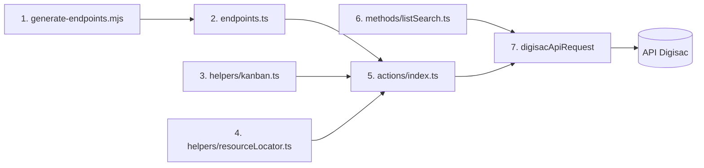

# Digisac: recurso Kanban (17 rotas novas)

**Approved**: 2026-11-06 - user: "implementa as rotas novas de todos"

> Build this with **tlc-implement**. Every criterion becomes a check with a proof; nothing under
> the open questions is settled while building.

## Problem

A API do Digisac tem um quadro Kanban de chamados (quadros, colunas e cards), mas o node `n8n-nodes-digisac` 1.1.0 não tem nenhuma rota dele. A coleção Postman oficial (publicada em 2026-03-17) traz 315 chamadas; o node cobre 298. A diferença são as 17 chamadas da pasta `Gerais > Kanban`. Quem automatiza funil de atendimento (mover o card de um chamado entre colunas, vincular um chamado a uma coluna) hoje precisa montar a chamada à mão em um node HTTP genérico, com a credencial separada.

O gerador numera as operações por posição na coleção (`e001`, `e002`...). As 17 rotas entram no meio da coleção; regerar o catálogo sem cuidado troca o ID de 148 operações que já existem. Workflow salvo guarda o ID da operação (por exemplo `e063`), então ele passaria a chamar outra rota do Digisac em silêncio.

Quando isso sair: o recurso `Kanban (General)` mostra as 17 operações; quadro e coluna aparecem como lista pesquisável da conta; apagar quadro, coluna ou card só funciona com o campo de confirmação ligado; nenhum workflow salvo muda de operação.

## Shape

Reutiliza o catálogo gerado (`DIGISAC_ENDPOINTS`), a montagem de path, query e body de `executeEndpoint`, o `withGuidedIds` do Resource Locator, o `listSearch` e o transporte `digisacApiRequest`, que já aplica `timeout` de 30 s. As regras que mudam o resultado (qual ID cada operação recebe, qual query sai, quando o apagar é recusado) ficam em módulos de `nodes/Digisac/` que os testes alcançam pelo `execute` e pelo `listSearch` do node compilado.

1. `scripts/generate-endpoints.mjs` (exists) - baixa a coleção, lê o `endpoints.ts` versionado, reaproveita o ID de cada rota já conhecida (método + URL + pasta) e numera as novas a partir do maior ID; normaliza `/v1/kanban-*` para `/api/v1/kanban-*`
2. `nodes/Digisac/generated/endpoints.ts` (exists) - passa de 298 para 315 entradas; as 17 novas levam `e299` a `e315`
3. `nodes/Digisac/helpers/kanban.ts` (new) - diz quais operações são apagar do Kanban, quais operações pedem campo auxiliar de quadro ou coluna e como a query dos três `Listar` é montada sem placeholder vazio
4. `nodes/Digisac/helpers/resourceLocator.ts` (exists) - ganha os tipos `boardId`, `columnId` e `cardId` (path, body e placeholders de query) como Resource Locator com lista, e os campos auxiliares de quadro e coluna
5. `nodes/Digisac/actions/index.ts` (exists) - cria o campo `Confirm Delete` das três operações de apagar e recusa a chamada antes da requisição quando ele está desligado
6. `nodes/Digisac/methods/listSearch.ts` (exists) - ganha `searchKanbanBoards`, `searchKanbanColumns` e `searchKanbanCards`
7. `digisacApiRequest` (exists) - envia a requisição; out: a resposta do Digisac como itens do n8n

**Changes underneath**

| Front | What changes |
| --- | --- |
| domain | nada: o recurso `Kanban (General)` é novo e nenhum termo muda de sentido |
| stored data | nothing to migrate: os 298 IDs de operação antigos ficam como estão, as 17 novas entram como `e299`-`e315` |
| readers | o editor do n8n mostra um recurso novo e, nos recursos antigos, nada novo; `docs/api-calls.md` e a tabela de recursos do README passam a listar 315 chamadas |
| generator | `scripts/generate-endpoints.mjs` deixa de numerar por posição e passa a reaproveitar os IDs do catálogo versionado |

Data: none - o node não guarda dado; ele só repassa a requisição ao Digisac e devolve a resposta.

New: nothing - read only.

## Surface

| Route | In | Out | Status | Who |
| --- | --- | --- | --- | --- |
| `GET /api/v1/kanban-boards` | `query={"paginate":false,"withTotal":false}` | lista de quadros | `200`; `401` com token inválido vira `NodeApiError` | quem tem credencial Digisac válida; sem ela o Digisac devolve `401` |
| `GET /api/v1/kanban-boards/{boardId}` | `boardId` | um quadro | `200`; `401`; `404` com ID inexistente | igual |
| `POST /api/v1/kanban-boards` | `name`, `departmentIds[]`, `timeoutAlertEnabled`, `visibleTickets` | o quadro criado | `200`; `401` | igual |
| `PUT /api/v1/kanban-boards/{boardId}` | `name`, `departmentIds[]`, `timeoutAlertEnabled`, `visibleTickets` | o quadro editado | `200`; `401` | igual |
| `DELETE /api/v1/kanban-boards/{boardId}` | `boardId`, `Confirm Delete` ligado | vazio | `200`; `401`; recusa local sem confirmação | igual |
| `GET /api/v1/kanban-columns` | `query` com `where.kanbanBoardId` opcional e `include` de `cards` | lista de colunas | `200`; `401` | igual |
| `GET /api/v1/kanban-columns/{columnId}` | `columnId`, `include[]=cards...` | uma coluna | `200`; `401`; `404` | igual |
| `POST /api/v1/kanban-columns` | `name`, `kanbanBoardId`, `isDraggable`, `ticketWaitTimeMinutes` | a coluna criada | `200`; `401` | igual |
| `PUT /api/v1/kanban-columns/{columnId}` (assumido com `/api`) | `name`, `isDraggable`, `ticketWaitTimeMinutes` | a coluna editada | `200`; `401`; `404` se o prefixo `/api` estiver errado | igual |
| `DELETE /api/v1/kanban-columns/{columnId}` | `columnId`, `cardsDestinationColumnId`, `Confirm Delete` ligado | vazio | `200`; `401`; recusa local sem confirmação | igual |
| `PATCH /api/v1/kanban-columns/{columnId}/reorder` | `beforeColumnId`, `afterColumnId` | a coluna reordenada | `200`; `401` | igual |
| `GET /api/v1/kanban-cards` | `query` com `where.columnId` e `customFilter.userIds` opcionais | lista de cards | `200`; `401` | igual |
| `GET /api/v1/kanban-cards/{cardId}` | `cardId` | um card | `200`; `401`; `404` | igual |
| `POST /api/v1/kanban-cards` | `columnId`, `ticketId` | o card criado | `200`; `401` | igual |
| `PUT /api/v1/kanban-cards/{cardId}` (assumido com `/api`) | `columnId`, `ticketId`, `position` | o card editado | `200`; `401`; `404` se o prefixo `/api` estiver errado | igual |
| `DELETE /api/v1/kanban-cards/{cardId}` | `cardId`, `Confirm Delete` ligado | vazio | `200`; `401`; recusa local sem confirmação | igual |
| `PATCH /api/v1/kanban-cards/{cardId}/reorder` | `beforeCardId`, `afterCardId`, `columnId`, `moveTo` | o card reordenado | `200`; `401` | igual |

## Landing

| One-way door | Literal shape | Alternative rejected |
| --- | --- | --- |
| ID da operação | as 298 operações antigas mantêm o `id` do catálogo 1.1.0; as 17 novas levam `e299` a `e315` (Jev 0,97) | renumerar por posição: troca 148 IDs e quebra workflow salvo; arquivo separado do Kanban: um segundo catálogo para manter |
| nome dos parâmetros novos | `path_e<id>_boardId`, `path_e<id>_columnId`, `path_e<id>_cardId` e `bodyFields_e<id>_fields`, pelo mesmo gerador de nomes das outras operações | nomes próprios do Kanban: ficariam fora do padrão de 298 operações |
| formato do valor de quadro, coluna e card | Resource Locator `{ __rl: true, mode: 'list' \| 'id', value: '<id>' }`, como os 8 tipos da 1.1.0 | texto livre: contraria a UX guideline que o pacote já segue |
| versão do pacote | `1.2.0` (minor: operação nova, nenhuma antiga muda) | `2.0.0`: sem quebra de contrato não se justifica |

- Nothing else in this change is hard to reverse

## Criteria

### S1: catálogo com as 17 rotas e IDs antigos intactos (P1)

O catálogo gerado passa a ter 315 chamadas, e toda chamada que já existia mantém o mesmo ID.

**Acceptance Criteria**

1. WHEN o gerador roda com a coleção de 315 chamadas e o `endpoints.ts` da 1.1.0 THEN o sistema SHALL gravar 315 entradas em que cada uma das 298 antigas tem o mesmo `id`, `method` e `rawUrl` de antes
   - `e063` continua sendo a mesma rota; a primeira rota nova recebe `e299` e a última `e315`
2. The catálogo SHALL ter, no recurso `general_kanban`, exatamente 17 chamadas com método e `pathTemplate` iguais à tabela `Surface`
3. IF a coleção traz `PUT {{URL}}/v1/kanban-columns/{{columnId}}` ou `PUT {{URL}}/v1/kanban-cards/{{cardId}}` THEN o gerador SHALL gravar `/api/v1/kanban-columns/{{columnId}}` e `/api/v1/kanban-cards/{{cardId}}`
   - `/v1/cards` e `/v1/cards/{{cardsId}}` (oportunidades do CRM, 3 operações antigas) → continuam sem `/api`
4. WHEN `npm run build` roda sem rede THEN o sistema SHALL sair com código 0, porque o gerador não faz parte do build

### S2: as 17 operações enviam a requisição certa (P1)

Cada operação do Kanban chama o método e o caminho da documentação, com os campos que a pessoa preencheu.

**Acceptance Criteria**

1. WHEN `GET /api/v1/kanban-boards` roda THEN o sistema SHALL enviar `GET /api/v1/kanban-boards` com `qs.query` `{"paginate":false,"withTotal":false}` e `timeout` `30000`
2. WHEN `Buscar quadro` roda com `boardId` `b1` THEN o sistema SHALL enviar `GET /api/v1/kanban-boards/b1`
3. WHEN `Criar quadro` roda com `name` `Vendas`, `departmentIds` `["d1"]` e `visibleTickets` `all` THEN o sistema SHALL enviar `POST /api/v1/kanban-boards` com body `{ name: 'Vendas', departmentIds: ['d1'], visibleTickets: 'all' }` e SHALL NOT enviar `timeoutAlertEnabled` que a pessoa não adicionou
   - `timeoutAlertEnabled` adicionado e ligado → body leva `timeoutAlertEnabled: true`; adicionado e desligado → `false`
4. WHEN `Editar quadro` roda com `boardId` `b1` e `name` `Vendas 2` THEN o sistema SHALL enviar `PUT /api/v1/kanban-boards/b1` com body `{ name: 'Vendas 2' }`
5. WHEN `Listar colunas` roda com o quadro `b1` THEN o sistema SHALL enviar `GET /api/v1/kanban-columns` com `qs.query` igual a `{"withTotal":false,"paginate":false,"where":{"kanbanBoardId":"b1"},"include":["cards","cards.ticket","cards.ticket.contact"]}`
   - sem quadro → a mesma query sem a chave `where`; a chave `include` e as chaves fixas ficam
6. WHEN `Buscar coluna` roda com `columnId` `c1` THEN o sistema SHALL enviar `GET /api/v1/kanban-columns/c1` com a query estática da coleção
7. WHEN `Criar coluna` roda com `name` `Em Andamento`, o quadro `b1` e `ticketWaitTimeMinutes` `60` THEN o sistema SHALL enviar `POST /api/v1/kanban-columns` com body `{ name: 'Em Andamento', kanbanBoardId: 'b1', ticketWaitTimeMinutes: 60 }`
   - `isDraggable` só vai quando adicionado: adicionado e ligado → `true`
8. WHEN `Editar coluna` roda com `columnId` `c1` e `name` `Triagem` THEN o sistema SHALL enviar `PUT /api/v1/kanban-columns/c1` com body `{ name: 'Triagem' }`
9. WHEN `Reordenar coluna` roda com `columnId` `c1`, `beforeColumnId` `c0` e `afterColumnId` `c2` THEN o sistema SHALL enviar `PATCH /api/v1/kanban-columns/c1/reorder` com body `{ beforeColumnId: 'c0', afterColumnId: 'c2' }`
10. WHEN `Listar cards` roda com a coluna `c1` e sem usuário THEN o sistema SHALL enviar `GET /api/v1/kanban-cards` com `qs.query` igual a `{"where":{"columnId":"c1"},"paginate":false,"withTotal":false}`
    - coluna `c1` e usuário `u1` → a query leva também `customFilter` `{"includeUnassigned":true,"userIds":["u1"]}`; sem coluna e sem usuário → só `paginate` e `withTotal`
11. WHEN `Buscar card` roda com `cardId` `k1` THEN o sistema SHALL enviar `GET /api/v1/kanban-cards/k1`
12. WHEN `Criar card` roda com `columnId` `c1` e `ticketId` `t1` THEN o sistema SHALL enviar `POST /api/v1/kanban-cards` com body `{ columnId: 'c1', ticketId: 't1' }`
13. WHEN `Editar card` roda com `cardId` `k1`, `columnId` `c2` e `position` `3` THEN o sistema SHALL enviar `PUT /api/v1/kanban-cards/k1` com body `{ columnId: 'c2', position: 3 }`
    - `position` não adicionado → o body não leva `position`
14. WHEN `Reordenar card` roda com `cardId` `k1`, `beforeCardId` `k0`, `columnId` `c2` e `moveTo` `top` THEN o sistema SHALL enviar `PATCH /api/v1/kanban-cards/k1/reorder` com body `{ beforeCardId: 'k0', columnId: 'c2', moveTo: 'top' }`
15. IF o campo de ID de path chega vazio THEN o sistema SHALL lançar `NodeOperationError` com a mensagem `The 'Board Id' parameter is empty [item 0]` (ou `Column Id`, `Card Id`) e a descrição `Paste the ID for Board Id`
    - `boardId` vazio na versão 2 → mensagem do quadro; `cardId` vazio → mensagem do card

### S3: apagar só com confirmação (P1)

As três operações de apagar do Kanban não enviam nada ao Digisac sem a confirmação ligada.

**Acceptance Criteria**

1. The node SHALL expor, em `Excluir quadro`, `Excluir coluna` e `Excluir card`, o campo booleano `Confirm Delete` com padrão `false` e descrição que começa com `Warning:`
2. IF `Confirm Delete` está desligado THEN o sistema SHALL lançar `NodeOperationError` com a mensagem `Turn on 'Confirm Delete' to delete this kanban board` (e `column`, `card`) antes de qualquer requisição HTTP
   - `Confirm Delete` ausente (valor padrão) → recusa e zero requisições gravadas
3. WHEN `Confirm Delete` está ligado e `Excluir quadro` roda com `boardId` `b1` THEN o sistema SHALL enviar `DELETE /api/v1/kanban-boards/b1`
4. WHEN `Excluir coluna` roda com `columnId` `c1`, `cardsDestinationColumnId` `c2` e a confirmação ligada THEN o sistema SHALL enviar `DELETE /api/v1/kanban-columns/c1` com body `{ cardsDestinationColumnId: 'c2' }`
5. WHEN `Excluir card` roda com `cardId` `k1` e a confirmação ligada THEN o sistema SHALL enviar `DELETE /api/v1/kanban-cards/k1`
6. The node SHALL NOT exigir `Confirm Delete` em nenhuma outra operação `DELETE` do catálogo
   - as outras `DELETE` do catálogo → sem o campo e sem recusa

### S4: quadro, coluna e card como lista pesquisável (P1)

Na versão 2 do node, quadro, coluna e card aparecem como lista da conta com o modo ID ao lado.

**Acceptance Criteria**

1. The node SHALL expor, para `@version` 2, como `resourceLocator` com modos `list` e `id`, os parâmetros de path `boardId`, `columnId` e `cardId` do Kanban, as chaves de body `kanbanBoardId`, `columnId`, `cardsDestinationColumnId`, `beforeColumnId`, `afterColumnId`, `beforeCardId` e `afterCardId`, e os placeholders `boardId` e `columnId` das queries de `Listar colunas` e `Listar cards`
2. WHEN o editor pede a lista de quadros THEN o `listSearch` SHALL chamar `GET /api/v1/kanban-boards` com `qs.query` `{"paginate":false,"withTotal":false}` e devolver `{ results: [{ name, value }] }`, filtrando o texto de busca no node sem acento nem maiúscula
   - texto `vend` → acha `Vendas`; resposta como array puro ou como `{ data: [...] }` → os dois lidos
3. WHEN o editor pede a lista de colunas e o campo auxiliar `Filter by Board` da operação tem o quadro `b1` THEN o `listSearch` SHALL chamar `GET /api/v1/kanban-columns` com `qs.query` `{"paginate":false,"withTotal":false,"where":{"kanbanBoardId":"b1"}}`
   - sem quadro no campo auxiliar → a mesma chamada sem `where`
4. WHEN o editor pede a lista de cards e o campo auxiliar `Filter by Column` da operação tem a coluna `c1` THEN o `listSearch` SHALL chamar `GET /api/v1/kanban-cards` com `qs.query` `{"where":{"columnId":"c1"},"paginate":false,"withTotal":false}`; IF o campo auxiliar está vazio THEN o `listSearch` SHALL devolver lista vazia sem chamar a API
5. The node SHALL expor os campos auxiliares `Filter by Board` e `Filter by Column` só na versão 2, só nas operações que escolhem coluna ou card, e SHALL NOT enviá-los na requisição
6. IF o Digisac responde `401` à chamada de qualquer das três listas THEN o sistema SHALL lançar `NodeApiError` com o código HTTP `401`
7. WHEN o `execute` roda na versão 2 com `{ mode: 'list', value: 'b1' }` ou `{ mode: 'id', value: ' b1 ' }` em quadro, coluna ou card THEN o sistema SHALL enviar `b1` sem espaço nas pontas

### S5: versões, compatibilidade e documentação (P2)

A versão 1 do node vê as operações novas com campos de texto; nada que existia muda; o pacote sobe para 1.2.0 com README e CHANGELOG em dia.

**Acceptance Criteria**

1. The node SHALL listar, para `@version` 1, todo parâmetro das 298 operações antigas com o mesmo `name` e `type` da 1.1.0, e as 17 operações novas SHALL aparecer na versão 1 com campos de texto no lugar dos Resource Locators
   - comparação das propriedades visíveis da versão 1 de `origin/main` contra o PR → só entradas novas, nenhuma alterada
2. The `package.json` SHALL ter `"version": "1.2.0"`, e o `CHANGELOG.md` SHALL ter a seção `## 1.2.0` com as 17 operações do Kanban, a numeração estável do gerador e a confirmação de apagar
3. The README SHALL listar as operações do Kanban na tabela de operações, trazer um exemplo de mover card de coluna e de apagar com confirmação, e citar as operações novas na seção de Tool de IA
4. WHEN `npm run generate:docs` roda THEN o sistema SHALL regravar `docs/api-calls.md` com 315 chamadas e a tabela de recursos do README, sem sobrescrever o restante do README
5. WHEN `npm run lint`, `npm test`, `npx tsc --noEmit` e `npm run build` rodam THEN o sistema SHALL sair com código 0 e `n8n-node lint` SHALL imprimir 0 erros

## Out of scope

| Excluded | Why |
| --- | --- |
| Trigger ou webhook de Kanban | A coleção não traz evento de webhook de Kanban |
| Campos novos em rotas que o node já cobre | A coleção não marca campo novo e a auditoria não comparou os 298 corpos campo a campo |
| Normalizar as três rotas antigas `/v1/cards` (oportunidades) | São de outra API do CRM, a coleção as traz sem `/api` e a 1.1.0 as chama assim; mudar o caminho mudaria a versão 1 |
| Corrigir `{{false}}` virar JSON `{}` em `isAdmin` de outras operações | Bug da 1.1.0 fora do pedido; mudar o tipo do campo mudaria a versão 1 |
| Lista de usuário no filtro `customFilter.userIds` de `Listar cards` | Placeholder de query complexa continua texto, como nas outras operações; só quadro e coluna ganham lista |
| Repetição de chave estática `include[]` em `Buscar coluna` | O catálogo inteiro guarda uma chave de query por nome; mudar isso mudaria a requisição das operações antigas |
| Rótulo do card pelo nome do contato | A resposta de `kanban-cards` não está documentada; o rótulo usa o que vier (`ticket.contact.name`, senão `id`) |

## Assumptions

| Assumption | Chosen default | Rationale | Confirmed? |
| --- | --- | --- | --- |
| Prefixo `/api` nos dois `PUT` | `/api/v1/kanban-columns/{id}` e `/api/v1/kanban-cards/{id}` | A coleção traz `/v1/...` sem `/api`, mas as outras 15 rotas do Kanban e as outras 295 do node usam `/api/v1`; a doc não confirma. Se o Digisac responder `404`, o caminho certo é o da coleção | n |
| Forma da resposta das listas | `{ data: [...] }` ou array puro; o rótulo vem de `name`, senão `id` | A coleção não traz esquema de resposta | n |
| Listas sem paginação | `paginate:false` devolve tudo numa chamada; o `listSearch` não devolve `paginationToken` | A query documentada de cada listagem usa `paginate:false` | n |
| `kanbanBoardId` no `where` de `kanban-columns` | O filtro `where.kanbanBoardId` da própria coleção filtra por quadro | Aparece em `Listar colunas` | y |
| Listar cards exige coluna | A lista de cards só chama a API com a coluna escolhida | A coleção só mostra o filtro `where.columnId`; sem filtro a resposta pode ser enorme | n |
| `position` é número | O campo `position` do body de `Editar card` é número | A coleção mostra `"1"` entre aspas; posição de cartão costuma ser inteiro. Se a API recusar, trocar para texto | n |
| `moveTo` | Texto livre com o exemplo `top` | A coleção mostra só `top`; os outros valores não estão confirmados | n |
| `visibleTickets` | Lista de opções `mine`, `mine-and-not-assigned`, `all` | O comentário do corpo na coleção lista os três valores | y |
| Idioma dos rótulos novos | Inglês, Title Case, como a UX guideline do n8n | O pacote já segue isso nos campos guiados | n |

**Open questions:** none - all resolved or logged above.

## Differences from the source

None - the product matches the source

## Sources

- Pedido do dono, 06/11/2026: "implementa as rotas novas de todos" - binding - escopo do trabalho
- Coleção Postman oficial do Digisac, `https://documenter.getpostman.com/view/53282970/2sBXihpXmF` (JSON em `https://documenter.gw.postman.com/api/collections/53282970/2sBXihpXmF`), pasta `Gerais > Kanban`, lida em 06/11/2026 - binding - método, caminho, corpo e query das 17 rotas
- Auditoria de rotas do Digisac, 06/11/2026 (`auditoria-digisac.md`) - binding - lista das 17 rotas e dos dois `PUT` sem `/api`
- Plano `.specs/features/node-cli-campos-v2/plan.md` e decisões `AD-002`, `AD-006`, `AD-007` em `.specs/STATE.md` - binding - versão leve do node e Resource Locator
